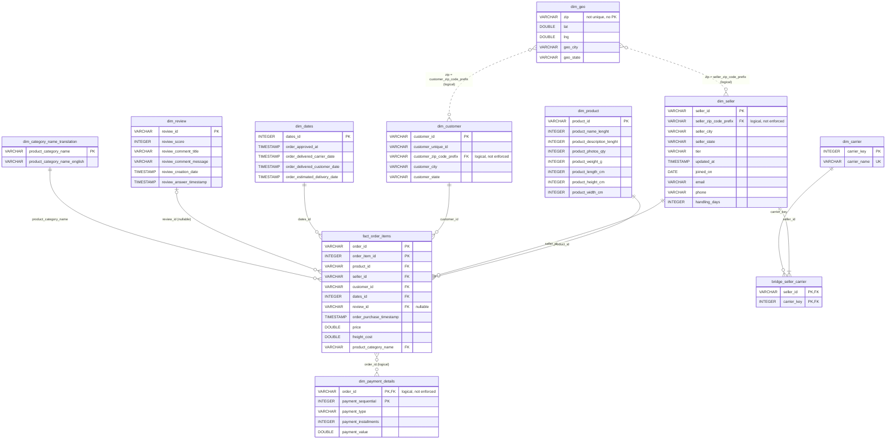

# PA01

## 1 - Profile Reporting

There were multiple inconsistencies found in both json and csv files. Regarding the JSON file the main inconsistencies were:

* Duplicated Sellers: There were multiple sellers that had the same information (sometimes they would differ in "tier"). Eg: seller 05730013efda596306417c3b09302475, with two different dates. The repeated records were deleted using the most recent value from the "updated_at" column as a the main criteria.

* Inconsistent Tier Naming: The "Tier" could be either "bronze", "silver" or "gold". However, there were multiple differences in case sensitiveness, eg: "Bronze" instead of "bronze".

* Lack of the "shipping" inner object: not every seller had the "shipping" object inside its scope. This implied that it wasn't possible to determine both the "handling_days" or "carrier" field. In these situations "handling_days" was set to 0 (as there were no records with 0 as value) and the "carrier" was set to NULL.

For the csv files there were problems with orphage rows, especially with the seller and orders CSVs. See tables bellow.

| fk_check | distinct_checked | distinct_without_match | rows_affected |
|---|--:|--:|--:|
| order_items.order_id → orders_raw.order_id | 98.666 | 1 | 1 |
| order_payments.order_id → orders_raw.order_id | 99.440 | 1 | 1 |
| orders_raw.order_id → order_items.order_id | 99.441 | 776 | 776 |

Something similar happened when trying to merge the JSON file with the CSV for the sellers. 

| check_name | distinct_checked | distinct_without_match |
|---|--:|--:|
| sellers_clean (JSON) → olist_sellers (CSV) | 3.070 | 15 |
| olist_sellers (CSV) → sellers_clean (JSON) | 3.095 | 40 |
| order_items → sellers_clean (JSON) | 3.095 | 40 |
| sellers_clean (JSON) → order_items (informativo: perfis sem vendas) | 3.070 | 15 |

Another issue found was the geolocation dimension. This dimension itself has basically not been cleaned as this would take manual validation. This happens because mispelled cities are hard to recognize and can refer to legitimate cities. Eg: Palma (MG) e Palmas (TO). Moreover, there are cities with the exact same name, eg: Bonito (PA) and Bonito (PA). There are also multiple ZIP_PREFIXES with different latitudes and longitudes. None of the problems stated above were solved. 

It was also discovered that there were products without categories and categories without english translations. Only the first situation was "solved", using a placeholder labeled "sem categoria".

## 2 - Diagram modeled

The fact table develop has the following columns:
* order_id;
* order_item_id;
* product_id;
* seller_id;
* customer_id;
* dates_id;
* review_id;
* order_purchase_timestamp;
* price;
* freight_cost
* product_category_name

Such arrangement allows to realize both queries requested in the exercise 4 without the need of any JOINs*. Such situation however, comes a at cost, resulting in logical links between the fact table and the payment dimension as the PK is now a composite of Order_ID and Order_Item_ID.

Another tough decision was how to model the carriers and geolocation. The carriers were solved using a NxN relationship to allow the Seller_ID to maintain it's PK properties. As previously said, the geolocation is inconsistent and, therefore, it was decided to create a logical link between this dimension and the remaining ones.

*PS: there is a JOIN in the third query, but its sole purpose is to return the name in English. If the user speaks Portuguese, the JOIN is not needed. 

## 3 - Agreggate seller (JSON) and seller (CSV)

Done according to the specifications.

## 4 - Benchmark

To run the benchmark execute the command "python export.py" from inside the /src folder, as the script uses relative paths.

## 5 - Question Answer

Using a lakehouse. The reasoning behind it lies both in the file type, size and processing speed.
First, an e-commerce website such as Olist would likely contain images and more JSONs. This type of unstructured is not supported by data warehouses. Regarding the file size, the benchmark shows that the data compression would reduce a huge part of the innerent waste of the data lakes. Moreover, the approach implemented showed an excellent querying speed, one of the main upsides of a data warehouse.

